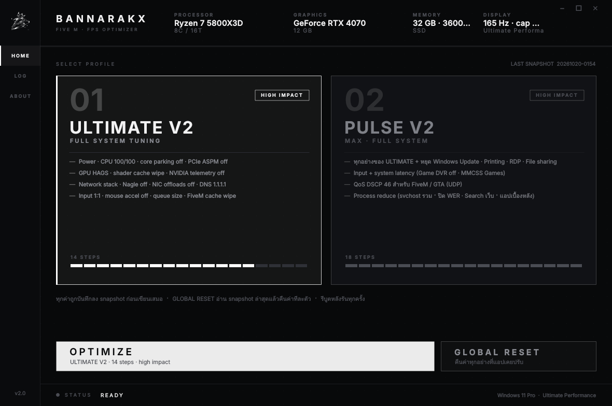
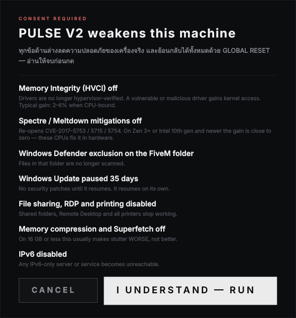

# BANNARAKX — FIVE M · FPS OPTIMIZER

<p align="center">
  
</p>

<p align="center">
  <em>แอป Windows หน้าเดียว · สองโปรไฟล์ · ปุ่มเดียว · ย้อนกลับได้ทั้งหมด</em>
</p>

<p align="center">
  <a href="#ใช้ยังไง">ใช้ยังไง</a> ·
  <a href="#สองโปรไฟล์">โปรไฟล์</a> ·
  <a href="#global-reset-ทำงานยังไง">การย้อนกลับ</a> ·
  <a href="#อ่านก่อนกด">ข้อควรรู้</a> ·
  <a href="docs/TWEAKS.md">รายการ tweak ทั้งหมด</a>
</p>

---

## ใช้ยังไง

**แบบง่าย** — โหลด `BANNARAKX.exe` จากหน้า [Releases](../../releases) แล้วเปิด แอปขอ Administrator เอง ไม่ต้องคลิกขวา

**รันจากซอร์ส**

```bat
pip install -r requirements.txt
python main.py
```

**Build เป็น exe เอง**

```bat
build.bat
```

ได้ `dist\BANNARAKX.exe` ไฟล์เดียว ไม่มีหน้าต่าง console

ขนาดราว 45 MB เพราะ PySide6 ติดมาทั้งชุด — `BANNARAKX.spec` ตัดโมดูลที่ไม่ใช้ออกแล้ว (WebEngine, Quick, Multimedia, Charts, SQL) ถ้าไม่ตัดจะราว 90 MB

> **เรื่อง antivirus**: exe ที่ build ด้วย PyInstaller + ขอ UAC โดน heuristic ของ Defender/SmartScreen ได้ สเปกไฟล์ปิด UPX ไว้แล้วเพราะ UPX บน Qt DLL เป็นสาเหตุ false positive อันดับหนึ่ง ถ้ายังโดนให้ใส่ exclusion ที่โฟลเดอร์ `dist`

---

## สองโปรไฟล์

|  | ULTIMATE V2 | PULSE V2 |
|---|---|---|
| ขั้นตอน | 14 | 18 |
| ทิศทาง | FPS สูงสุด เฟรมนิ่ง | ทุกอย่างของ ULTIMATE แล้วบีบ latency ต่อ |
| เพิ่มจาก ULTIMATE | — | หยุดงานเบื้องหลัง · latency pass · QoS DSCP 46 · ลดโปรเซส |

PULSE เป็น superset ของ ULTIMATE แบบตรงตัว — step 14 ตัวแรกคือชุดเดียวกัน ไม่ใช่แค่เขียนไว้ใน README แต่มี [เทสต์บังคับไว้](tests/test_profiles.py)

ดูรายการ step ทุกตัวและสิ่งที่มันแตะได้ที่ [`docs/TWEAKS.md`](docs/TWEAKS.md) ซึ่งถูก generate จากโค้ดจริง ไม่ได้เขียนมือ

---

## GLOBAL RESET ทำงานยังไง

ทุกค่าที่แอปเขียน จะบันทึกค่าเดิมลง snapshot JSON **ก่อน** เขียนเสมอ

```
%PROGRAMDATA%\BANNARAKX\backups\backup-YYYYMMDD-HHMMSS-ffffff.json
%PROGRAMDATA%\BANNARAKX\logs\run-YYYYMMDD-HHMMSS-ffffff.log
```

GLOBAL RESET อ่าน snapshot ล่าสุดแล้วคืนค่าทีละตัว **ย้อนลำดับ**

| สภาพก่อนปรับ | ตอน reset |
|---|---|
| ค่าเดิมมีอยู่ | เขียนค่าเดิมกลับ |
| key มี แต่ไม่มีค่านั้น | ลบเฉพาะค่านั้น |
| key เพิ่งถูกสร้าง | ลบทั้ง key |

ที่ต้องย้อนลำดับเพราะหลายค่าลงใน key ที่เพิ่งสร้างอันเดียวกัน — ชุด QoS เขียน 11 ค่าใน key เดียว ถ้าไล่หน้าไปหลัง entry แรกจะลบ key ทิ้งก่อน แล้วอีก 10 ค่าที่เหลือ restore ไม่ได้ มี [เทสต์ครอบเคสนี้ไว้](tests/test_restore.py)

นอกจาก registry ยังคืน service, power scheme, TCP autotuning, NIC properties, memory compression, NTFS last-access และ DNS กลับเป็น DHCP ด้วย

---

## อ่านก่อนกด

ทั้งสองโปรไฟล์ลดความปลอดภัยของเครื่องจริง แอปขึ้น dialog บอกรายข้อก่อนรันทุกครั้ง

<p align="center">
  
</p>

ตัวเลขที่ควรรู้ก่อน ไม่ใช่คำโฆษณา:

- **Memory Integrity (HVCI) off** — ได้ 2–6% เฉพาะตอน CPU-bound แลกกับ driver ที่มีช่องโหว่เข้าถึง kernel ได้
- **Spectre / Meltdown off** — บน Zen 3+ หรือ Intel 10th gen ขึ้นไป **ได้เกือบศูนย์** เพราะ CPU แก้ที่ hardware แล้ว
- **Memory compression off** (PULSE) — RAM 16GB หรือน้อยกว่า อันนี้ทำให้ **กระตุกหนักกว่าเดิม** ไม่ใช่ดีขึ้น
- **Windows Update paused 35 วัน** (PULSE) — ไม่มี security patch จนกว่าจะครบ แล้วกลับมาเอง
- **File sharing / RDP / printing ปิด** (PULSE) — เครื่องพิมพ์กับโฟลเดอร์แชร์หยุดทำงาน

ถ้าเครื่องเป็น CPU รุ่นใหม่ + RAM 16GB ใช้ **ULTIMATE** พอ

---

## สิ่งที่แอปทำแทนไม่ได้

เรียงตามผลจริง ไม่ได้เรียงตามความยาก

1. **เปิด XMP / EXPO ใน BIOS** — RAM หลายเครื่องวิ่ง 2133 MHz ทั้งที่ซื้อมา 3600 ข้อนี้ได้ FPS มากกว่าทุกอย่างในแอปรวมกัน แอปตรวจให้และเตือนบนหน้าหลักถ้าเจอ
2. **ใช้สาย LAN** — jitter ของ Wi-Fi กินทุก network tweak ในนี้
3. **FPS cap = refresh rate ลบ 3** + Low Latency Mode Ultra (แอปคำนวณเลขให้บนหัวหน้าจอ)
4. **G-Sync/FreeSync เปิด · VSync ไดรเวอร์เปิด · VSync ในเกมปิด**
5. **Population Density + Distance Scaling เหลือ 0–30%** — CPU win ที่ใหญ่สุดในเซิร์ฟคนเยอะ

---

## โครงโปรเจกต์

```
main.py                 หน้าต่าง, worker thread, consent dialog
core/
  backup.py             snapshot store
  engine.py             registry / service / task / powercfg primitives + GLOBAL RESET
  profiles.py           นิยาม step ทั้งหมด + ข้อความเตือน
  sysinfo.py            อ่านสเปกเครื่องจริงขึ้นหัวหน้าจอ (read-only)
ui/
  theme.py              design token + QSS
  widgets.py            ไทล์โปรไฟล์, ปุ่ม, meter, progress, dot grid
tests/                  เทสต์การย้อนกลับ กับความถูกต้องของตาราง profile
docs/
  TWEAKS.md             generate จากโค้ด
  gen_tweaks.py         ตัว generate
```

## Dev

```bash
pip install -r requirements-dev.txt
pytest          # เทสต์รันได้ทุก OS — ใช้ registry จำลองใน tests/fakereg.py
ruff check .
python docs/gen_tweaks.py
```

CI รันเทสต์กับ lint บน Ubuntu แล้ว build exe บน Windows ทุก push  
ติด tag `v*` แล้ว push จะ build + ปล่อย release พร้อม SHA256 ให้เอง

## License

[MIT](LICENSE)
